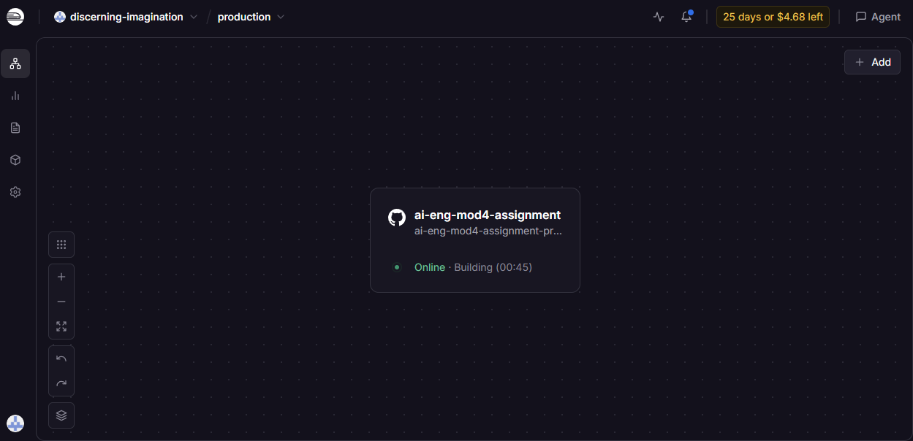
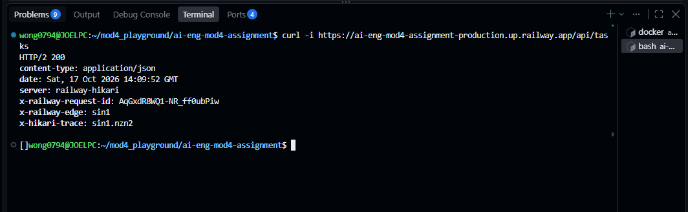
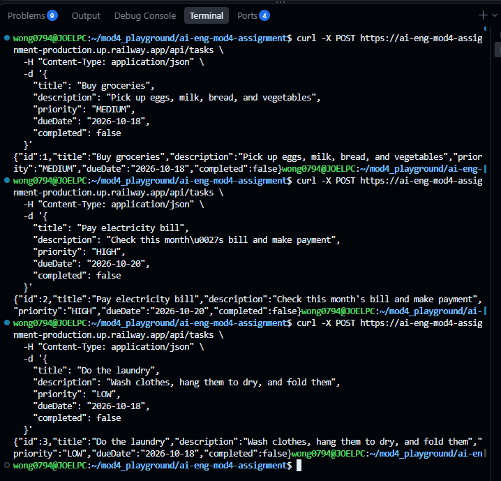
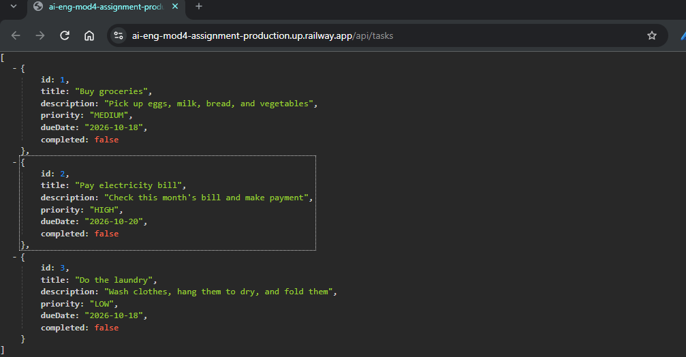
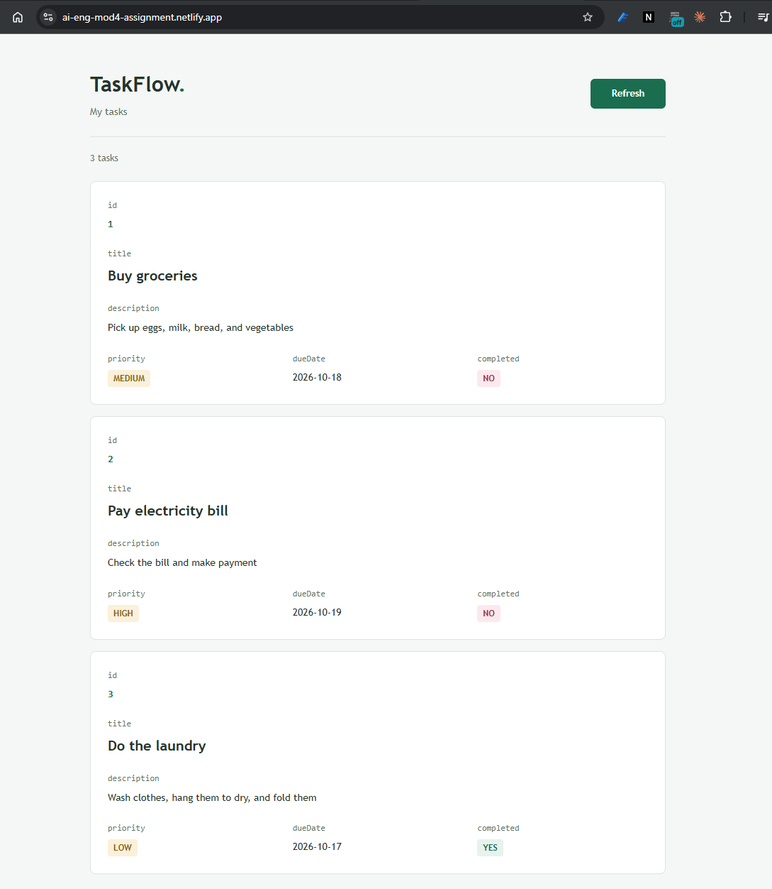
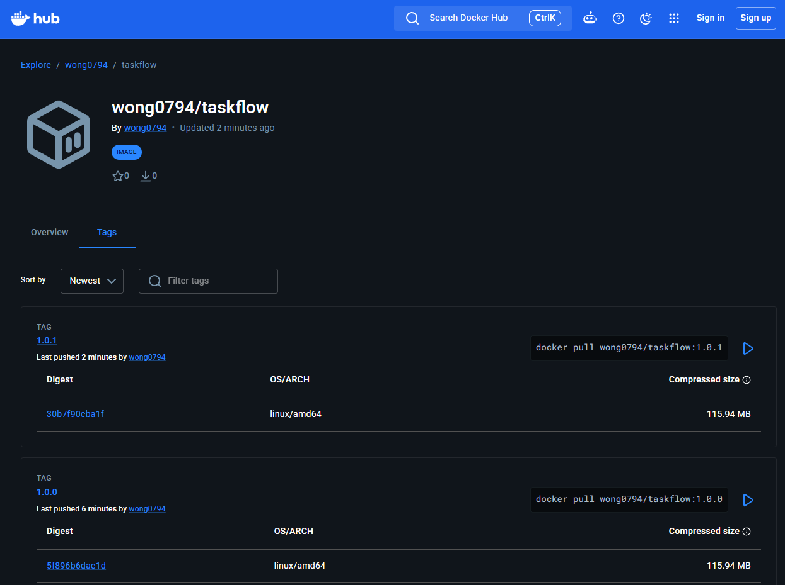

# TaskFlow API

A task management REST API built with Spring Boot, containerized with Docker and deployed on Railway for the **Module 4 - End of Module Assignment**. A React frontend is deployed on Netlify.

## 0.1 SUMMARY OF COMPLETED TASKS

- Completed the mandatory assignment requirements: built and tested the Docker image locally, deployed the API on Railway, and verified the live endpoint.
- Stretch goals:
  - Option 2: Deployed a React frontend on Netlify and configured CORS for the Railway API.
  - Option 4: Published Docker image versions `1.0.0` and `1.0.1` to Docker Hub. The `latest` tag still needs to be confirmed as pointing to `1.0.1`.

## 1. Assignment Submission Description

### 1.1 Live Application URL

TaskFlow API deployed on Railway:

```
https://ai-eng-mod4-assignment-production.up.railway.app/api/tasks
```

### 1.2 Screenshot: Railway Dashboard

This is the Railway dashboard showing the active deployment.



### 1.3 Screenshot: Live Application

(a) Tested the live Railway API from the terminal before adding tasks.



(b) Used POST requests to add everyday tasks, such as buying groceries, paying an electricity bill, and doing laundry.



(c) Verified that the live Railway API returned the newly created tasks as JSON.



## 2. Stretch Goals

### 2.1 Stretch Goal: Option 2

Deployed a React frontend on Netlify that fetches tasks from the Spring Boot API on Railway. Configured backend CORS to allow requests from the Netlify domain. The frontend displays each task's fields and shows completion as a green YES or a red NO.

Added startup seed data so the frontend displays sample tasks after each backend restart or redeployment. The initializer inserts three everyday tasks only when the database is empty, demonstrating both completed and incomplete states. This provides demo data; it does not preserve manually added tasks across restarts.

Frontend URL: https://ai-eng-mod4-assignment.netlify.app



### 2.2 Stretch Goal: Option 4

Published versioned Docker images to Docker Hub so a specific release can be pulled without rebuilding the source code.

Docker Hub repository: https://hub.docker.com/r/wong0794/taskflow

| Version | Description                                                                                        |
| ------- | -------------------------------------------------------------------------------------------------- |
| `1.0.0` | Initial published TaskFlow API image, including startup sample tasks.                              |
| `1.0.1` | Updated the seeded electricity bill task description to be more elaborate and to demo change made. |

Images use `MAJOR.MINOR.PATCH` versioning.



## 3. Brief Description of This Project

TaskFlow is a backend API for keeping track of everyday tasks, such as buying groceries, paying bills, and doing laundry. Each task has an automatically generated ID, a title, a description, a priority, a due date, and a completion status.

### 3.1 What the API Does

The API accepts and returns JSON data rather than displaying a graphical task management interface. Opening the [live tasks endpoint](https://ai-eng-mod4-assignment-production.up.railway.app/api/tasks) in a browser shows the tasks currently stored in the deployed application.

| Method | Endpoint          | Purpose                                       |
| ------ | ----------------- | --------------------------------------------- |
| GET    | `/api/tasks`      | Retrieve all tasks.                           |
| GET    | `/api/tasks/{id}` | Retrieve an existing task by its ID.          |
| POST   | `/api/tasks`      | Create a task by sending its details as JSON. |

New tasks are added using an HTTP client such as curl or Postman. Refreshing the live tasks endpoint then shows the updated list. If no tasks are stored, the API returns an empty JSON array (`[]`).

### 3.2 How It Runs

The application is built with Spring Boot and Java 21, with Maven managing its dependencies and build process. A multi-stage Dockerfile first builds the application JAR, then copies it into a smaller Java runtime image. Railway builds and runs the container to make the API publicly accessible. Netlify builds and hosts the React frontend, which requests data from Railway. Docker Hub stores separately published, versioned backend images; it does not replace the Railway deployment.

### 3.3 Data Storage Limitation

Tasks are stored in an in-memory H2 database. Manually added tasks are lost whenever the backend restarts or redeploys. To keep the presentation populated, a startup initializer now inserts three sample tasks if the database is empty: buying groceries, paying an electricity bill, and doing laundry. Laundry is marked completed so the frontend demonstrates both YES and NO labels.

The sample due dates are based on the backend's startup date. Seeding runs when the backend starts, not whenever someone visits Netlify, and leaves existing tasks unchanged. This is demo-data initialization, not persistent storage. The earlier screenshots show tasks that were added manually using POST requests.
